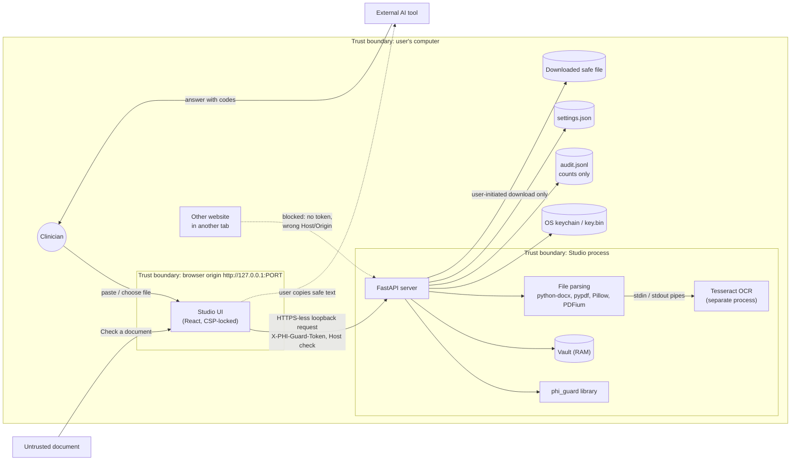

# Threat model: phi-guard v0.2 and phi-guard Studio

This document describes what phi-guard protects, who might attack it, how, and what stops them. It uses
**STRIDE** (Spoofing, Tampering, Repudiation, Information disclosure, Denial of service, Elevation of
privilege) per component. Every mitigation marked ✅ has an automated test; the test name is given.

## 1. Assets

| Asset | Why it matters |
|---|---|
| **A1. Patient details in text and files** (names, OHIP, SIN, DOB, contact details) | The thing we exist to protect. Disclosure harms patients and breaks privacy law. |
| **A2. The token vault** (code → original value) | Turns safe text back into patient details. |
| **A3. The HMAC protection key** | With it, anyone can test guesses against codes ("is `[PATIENT_NAME_a2b6…]` Jane Doe?"). |
| **A4. The activity log** | The privacy officer's evidence of what was processed. |
| **A5. Integrity of AI inputs** | A poisoned document can make an AI tool leak data or act on false instructions. |

## 2. Actors

| Actor | Capability |
|---|---|
| **Malicious website** the user visits while Studio is running | Can make the browser send requests to `127.0.0.1:*`, try DNS rebinding, frame pages. Cannot read responses from other origins. |
| **Author of a poisoned document** | Controls text that will reach an AI tool (indirect prompt injection). |
| **Another device on the same network** | Can connect to any port the machine exposes on a non-loopback interface. |
| **Local user / malware on the same account** | Can read the user's files and memory. **Out of scope**: no local app can defend against code already running as the user. |
| **Careless but honest user** | Pastes the wrong thing, leaves the computer unlocked, trusts a result too much. |
| **AI model** | May echo, invent or leak identifiers in its answers. |

## 3. Data flow

Patient details cross the computer's boundary **only** when the user copies or downloads the *safe* version.

## 4. STRIDE by component

### 4.1 Local web server (Studio backend)

| Threat | STRIDE | Mitigation | Test |
|---|---|---|---|
| Another device on the LAN calls the API | I, E | Binds to `127.0.0.1` only; non-loopback addresses refused unless `--allow-network`, which prints a loud warning. ✅ | `test_refuses_non_local_bind_without_flag`, `test_random_port_binds_loopback_only` |
| A website the user visits sends `POST /api/restore` from the browser (CSRF) | S, I | Every `/api` request must carry a random per-launch token in `X-PHI-Guard-Token`. A cross-site page cannot read the token, and a custom header forces a CORS preflight that Studio never approves. Constant-time comparison. ✅ | `test_token_required` |
| DNS rebinding: `evil.example` re-resolves to 127.0.0.1 so the browser treats Studio as same-origin with the attacker | S, I | Host header must be `127.0.0.1`, `localhost` or `[::1]` (with Studio's port). ✅ | `test_host_header_check_blocks_dns_rebinding` |
| Request from a foreign origin that somehow has the token | S | `Origin`, when present, must be Studio's own. ✅ | `test_foreign_origin_rejected` |
| Port guessing | I | Random port per launch (the token, not the port, is the real control). | `test_random_port_binds_loopback_only` |
| Token leaks via URL, Referer or logs | I | Token travels in the URL **fragment**, which browsers never send to servers; the page strips it from the address bar immediately; `Referrer-Policy: no-referrer`; uvicorn access log disabled. ✅ | E2E `security in the browser…` |
| Error messages reveal patient details | I | Generic error handler never echoes exception text. | `test_unknown_api_path_and_validation_errors` |
| Huge request or upload exhausts memory | D | Per-file (20 MB) and per-batch (100 MB / 200 files) limits, checked from `Content-Length` and again after reading; text fields capped; scrypt parameters bounded on key import. ✅ | `test_upload_size_limit`, `test_batch_limits_and_missing_jobs`, `test_export_roundtrip_and_tamper` |
| API docs or server banner aid an attacker | I | OpenAPI/docs routes disabled; `server` header off. ✅ | `test_no_server_banner_or_docs` |

### 4.2 Browser and frontend

| Threat | STRIDE | Mitigation | Test |
|---|---|---|---|
| Cross-site scripting via a malicious document's text | T, E | React escapes all text; no `dangerouslySetInnerHTML`; strict CSP (`default-src 'self'; script-src 'self'`, no `unsafe-inline`, no external origins) as a second layer. ✅ | `test_security_headers_present`; E2E checks no CSP violations |
| Clickjacking Studio inside another site | T | `X-Frame-Options: DENY` and `frame-ancestors 'none'`. ✅ | `test_security_headers_present` |
| Patient text persisted by the browser | I | API responses `Cache-Control: no-store`; nothing written to `localStorage`; only the session token (not patient data) in `sessionStorage`. ✅ | `test_headers_on_rejected_requests_and_no_store_on_api`; Vitest "never stores patient text"; E2E storage check |
| Third-party script or CDN compromise (supply chain at runtime) | T | No CDNs: everything is bundled and served from `'self'`. | CSP test |
| `window.opener` tab-nabbing | T | `Cross-Origin-Opener-Policy: same-origin`, downloads use `rel="noopener"`. | header test |

### 4.3 File parsing

| Threat | STRIDE | Mitigation | Test |
|---|---|---|---|
| Executable renamed `notes.txt` | E | Type decided by magic bytes, and must match the extension; executables, scripts with shebangs and archives refused with a plain-language message. ✅ | `test_upload_rejects_executables_and_archives` |
| ZIP renamed `.docx` (or zip bomb) | D, E | A `.docx` must be a ZIP containing `word/document.xml`; plain archives refused. | `test_upload_rejects_zip_renamed_docx` |
| Malformed PDF/DOCX crashes the parser | D | Parser errors caught and reported as "damaged file"; library parsers do not execute content. | `test_damaged_pdf_and_docx` |
| Upload spooled to a temp file (patient data on disk) | I | Starlette's 1 MB spool threshold raised to the upload limit; uploads stay in RAM. ✅ | `test_uploads_never_touch_disk` (fails if any temp file is created) |
| Batch file names like `../../etc/passwd` (zip slip) | T | Paths sanitized: no `..`, absolute paths or drive letters. ✅ | `test_batch_paths_cannot_escape_zip`, `test_batch_end_to_end` |
| CSV formula injection via file names in `summary.csv` | T | Cells starting with `= + - @` are prefixed with `'`. ✅ | `test_summary_csv_blocks_formula_injection` |
| Scanned PDF silently treated as "no patient details" | I | Pages without a text layer are read with OCR; if no text can be found (or OCR is unavailable or off), an explicit message is shown, never an empty result. ✅ | `test_text_pdf_and_blank_scan`, `test_scanned_pdf_without_ocr_engine` |

### 4.4 Key storage

| Threat | STRIDE | Mitigation | Test |
|---|---|---|---|
| Key displayed or returned by the API | I | Only an 8-hex-character SHA-256 fingerprint is ever shown. ✅ | `test_key_file_fallback_is_private_and_never_returned` |
| Key stolen from disk | I | OS keychain preferred. Fallback `key.bin` is AES-GCM-encrypted under a scrypt key derived from machine identity, mode 0600, **labelled as weaker** in Settings. Protects against copying to another machine, not against malware as the same user. ✅ | `test_keychain_backend_preferred`, `test_file_from_another_machine_is_rejected` |
| Exported key file brute-forced | I | scrypt (n=2^15, r=8, p=1) + AES-256-GCM, random salt and nonce, minimum 10-character password, warnings in the UI. ✅ | `test_export_roundtrip_and_tamper` |
| Malicious key file (absurd KDF parameters) | D | Parameters bounded before use. ✅ | `test_export_roundtrip_and_tamper` |
| Old codes restorable after a key change | I | Rotating or importing a key clears the vault. ✅ | `test_key_rotate_export_import` |

### 4.5 Vault and session

| Threat | STRIDE | Mitigation | Test |
|---|---|---|---|
| Unattended computer: someone restores names later | I | Vault in RAM only; cleared on Start over, on exit, on key change, and after 30 idle minutes (configurable), with a visible countdown under 2 minutes; polling the countdown does not count as activity. ✅ | `test_vault_cleared_after_idle_timeout`, `test_vault_cleared_after_timeout_through_api`, `test_start_over_and_shutdown_clear_vault` |
| Codes reversed without the vault | I | Codes are HMAC-SHA256 (keyed), not plain hashes, so they cannot be brute-forced from a list of common names without the key. | `test_pseudonymize_is_deterministic_per_key` |

### 4.6 Activity log

| Threat | STRIDE | Mitigation | Test |
|---|---|---|---|
| Log edited, reordered or truncated in the middle | T, R | SHA-256 hash chain; `verify()` reports the first broken entry; Studio shows it in plain language. ✅ | `test_audit_chain_verifies_and_detects_tampering`, `test_audit_list_filter_verify_tamper_export` |
| Whole log rewritten with a fresh chain | T, R | **Residual risk.** Mitigation: export the log or print the summary regularly (anchors the latest hash outside the machine). |
| Log leaks patient data | I | Entries hold counts, types, verdicts; never text or file names. ✅ | `test_audit_log_contains_no_phi_after_full_workflow` |

### 4.7 Detection and AI-facing risks

| Threat | STRIDE | Mitigation | Test / evidence |
|---|---|---|---|
| Identifier missed by the detectors and sent to the AI | I | Human review step (highlights, Keep/Remove, manual add); word lists; optional NER; "Please check" on low-confidence findings. **Residual risk, measured**: 22% document leakage on the test split, 100% on the held-out template. | `eval/RESULTS.md` |
| Poisoned document manipulates an AI tool (indirect injection) | T, E | Heuristic screening with normalization (NFKC, invisible characters, confusables, leetspeak, Base64); traffic-light verdict; `wrap_untrusted()` for developers. **Residual risk, measured**: 70% detection, 0% on unseen phrasings. | `eval/RESULTS.md`, `test_inject_poisoned_example_is_red_and_clean_policy_green` |
| AI answer leaks or invents identifiers | I | Output scan ignores known codes and flags real-looking identifiers and unknown codes. ✅ | `test_output_scan_ignores_known_codes` |
| Over-trust ("it said safe, so it's safe") | — | UI copy states limits plainly ("It can miss new tricks"); Help explains what Studio can't do. | Help page |

### 4.8 Scanned documents (OCR)

| Threat | STRIDE | Mitigation | Test |
|---|---|---|---|
| Scanned referral written to disk by the OCR step | I | Tesseract is run as a subprocess fed through stdin/stdout pipes (no `pytesseract`, which writes temp files). Verified with the temp directory pointed at an empty folder, and by running the Docker image. ✅ | `test_ocr_never_writes_temporary_files` |
| Decompression bomb (tiny file, gigantic image) or a 500-page fax | D | 40-megapixel cap per page, Pillow's bomb warning treated as an error, at most 30 OCR pages, 300 dpi rendering. ✅ | `test_image_too_large_is_refused`, `test_too_many_pages_is_refused` |
| Malformed image crashes or hangs the app | D | Images are decoded by Pillow/PDFium with errors turned into plain messages; recognition runs in a separate Tesseract process with a 90-second limit per page. ✅ | `test_damaged_files`, `test_tesseract_failures_become_plain_errors` |
| Command injection through the OCR language setting | E | The language is validated against `[a-z]{3}(+[a-z]{3})*` and only two values are offered; Tesseract is called with an argument list, never a shell. ✅ | `test_invalid_language_rejected` |
| OCR misreads a name or number, so it is not detected and leaks | I | **Residual risk, measured** (`eval/RESULTS_OCR.md`): documents with any leak rise from 24% (typed) to 41% (standard fax) and 77% (bad fax). Mitigations: confidence shown on upload, a notice asking users to compare names and numbers, side-by-side page previews, editable text before Find. | `eval/RESULTS_OCR.md`, E2E faxed-referral test |
| Redacted scan still leaks: text hidden under boxes, or boxes revealing word lengths | I | Output is an image-only PDF (no text layer); one box per detail per line. The benchmark measures ink coverage at true character positions: boxes cover 99.3% of details removed from the text. ✅ | `test_redacted_scan_hides_details_and_has_no_text_layer`, `test_redaction_box_hides_word_count_and_lengths` |
| Redacted scan offsets drift from what the user reviewed | T | The server re-runs deterministic OCR on the same file; the download is disabled if the user edited the OCR text. ✅ | E2E "editing OCR text disables the redacted-scan download" |
| Prompt injection hidden in a scanned document | T, E | OCR text goes through the same "Check a document" screening as typed text. | `test_inject_*` |
| Tampered or outdated bundled Tesseract | T | Windows builds bundle Tesseract from the package manager in CI; Dependabot does not cover it, so it must be updated with each release. **Residual risk.** | Release workflow |

### 4.9 Supply chain and build

| Threat | Mitigation |
|---|---|
| Vulnerable dependency | `pip-audit` and `npm audit --omit=dev` in CI; Dependabot for pip, npm and GitHub Actions; exact npm versions with a lockfile. |
| Telemetry or phoning home | None exists. Every Studio test runs with non-loopback network blocked, including a real-socket workflow (`test_real_server_full_workflow_makes_no_external_calls`). |
| Tampered desktop build | Builds come from CI on tags. **Residual risk:** not code-signed (see DECISIONS.md D36). |
| Container exposure | Non-root user; docs publish to `127.0.0.1` only; CI smoke-tests token enforcement and UID. |

## 5. Out of scope

* Malware or another person already running code as the logged-in user.
* Physical access to an unlocked, running computer beyond the idle timeout.
* The security of the external AI tool once the user pastes the safe text into it.
* Legal compliance determinations. phi-guard is designed to support privacy practices; it does not certify them.

## 6. Residual risks (summary)

1. Detection misses (measured, see results); mitigated by human review, not eliminated. OCR misreads on faxes add to them (measured in `eval/RESULTS_OCR.md`).
2. Novel prompt-injection phrasing; heuristics are a triage signal only.
3. Whole-log rewrite; mitigated by exporting or printing the log.
4. Keychain fallback is obfuscation, not strong protection.
5. Unsigned binaries.
