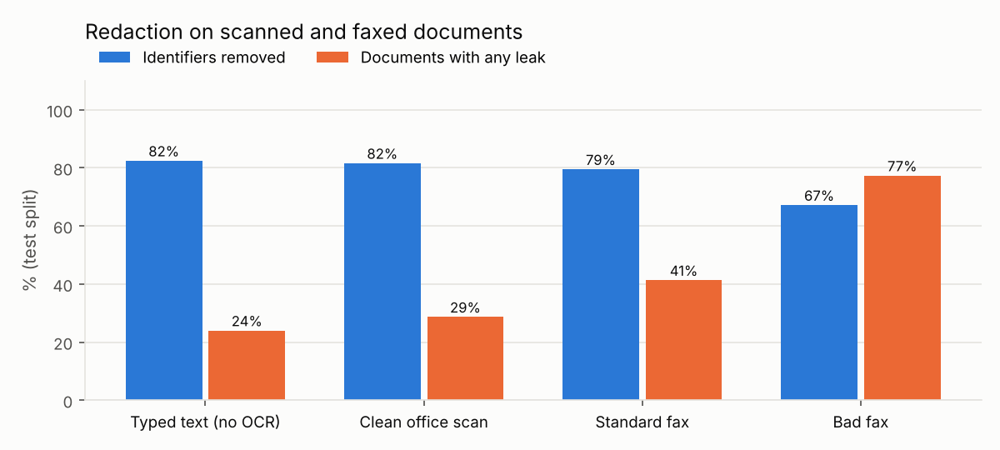

# Benchmark results: scanned and faxed documents

> Auto-generated by `python -m eval.ocr_eval`. Main results: [RESULTS.md](RESULTS.md).

* 150 test-split documents (1179 labelled identifiers), rendered as page images at three quality levels by `eval/fax.py`.
* OCR: Tesseract 5.3.4 (English), 3x3 median filter, automatic page layout. These choices were made on dev documents only and frozen in a commit before this ran.
* Redaction: phi-guard default configuration, unchanged.
* A detail **survives** if it still appears in the redacted output exactly or nearly (OCR misreads like `Whitfie1d` still reveal the name); names are checked word by word. Lower survival is better.

| Input | Character error rate | Identifiers removed | Documents with any leak | OCR seconds per page |
|---|---:|---:|---:|---:|
| Typed text (no OCR) | – | 82.4% | **24.0%** | 0.00 |
| Clean office scan | 0.1% | 81.6% | **28.7%** | 1.00 |
| Standard fax | 0.3% | 79.5% | **41.3%** | 0.75 |
| Bad fax | 2.1% | 67.2% | **77.3%** | 0.74 |

## Identifiers removed, by type

Types with fewer than 20 examples (marked *) are too rare here for their percentages to mean much.

| Type | Examples | Typed text (no OCR) | Clean office scan | Standard fax | Bad fax |
|---|---:|---:|---:|---:|---:|
| Name | 378 | 58.2% | 57.4% | 57.9% | 51.3% |
| Date of birth | 150 | 80.0% | 80.0% | 78.0% | 61.3% |
| OHIP number | 138 | 100.0% | 100.0% | 94.2% | 83.3% |
| SIN * | 5 | 100.0% | 100.0% | 100.0% | 60.0% |
| Credit card * | 2 | 100.0% | 50.0% | 100.0% | 50.0% |
| Email | 62 | 100.0% | 100.0% | 98.4% | 96.8% |
| Phone | 135 | 99.3% | 99.3% | 98.5% | 85.2% |
| Postal code | 112 | 100.0% | 94.6% | 87.5% | 62.5% |
| Street address | 112 | 83.9% | 83.9% | 83.0% | 75.0% |
| MRN | 66 | 100.0% | 100.0% | 93.9% | 68.2% |
| IP address * | 19 | 100.0% | 100.0% | 89.5% | 68.4% |

## Redacted copy of the scan (black boxes), standard fax

For every labelled detail we know exactly where it was drawn on the page (including the fax skew), and measure how much of its ink (dark pixels) lies under a black box. A detail counts as hidden if at least 98% of its ink is covered.

| Measure | Result |
|---|---:|
| Details removed from the redacted text | 79.5% |
| Details hidden by black boxes on the redacted scan | 79.6% |
| Of the details removed from the text, also hidden by the black boxes | 99.3% |
| Redacted scans with any detail not fully covered | 40.7% |

## Examples of details that survived on a standard fax (synthetic)

* `POSTAL_CODE`: `P4S 9H6`
* `IP_ADDRESS`: `10.100.185.164`
* `NAME`: `Amanda Fernandez`
* `DATE_OF_BIRTH`: `29-May-1995`
* `NAME`: `Katelyn Fernandez`
* `ADDRESS`: `480b floyd dr #968`
* `DATE_OF_BIRTH`: `03-May-1983`
* `ADDRESS`: `5338 taylor st`
* `POSTAL_CODE`: `A5A 7B6`
* `OHIP_NUMBER`: `9681-152-923`
* `OHIP_NUMBER`: `6564-142-146`
* `MRN`: `5849035`
* `MRN`: `H-145894`
* `PHONE`: `+1 604 265 6709`
* `IP_ADDRESS`: `172.108.99.185`
* `PHONE`: `2891510335`
* `EMAIL`: `justin8@example.net`

## Discussion

The OCR pipeline (Tesseract, a 3x3 median filter, automatic page layout) was chosen on dev documents and
frozen in a commit before this test run. The one later change, merging each detail's words into one black box
per line, was also made on dev data and committed before this run. Nothing was changed after seeing these numbers.

### What works well

* **Clean scans are nearly as good as typed text.** Character errors are about 0.1%, and redaction removes
  81.6% of identifiers versus 82.4% from the typed original. For a referral scanned on an office copier, the
  scan itself costs almost nothing.
* **The redacted copy of the scan is reliable.** Of the details removed from the text, 99.3% were also fully
  covered by black boxes on the scan, measured against the exact positions where each character was drawn.
  The output is image-only, so nothing hidden survives under the boxes.
* **It's fast enough:** under a second per page on a laptop CPU.

### Where it fails

* **Faxes add leaks, and bad faxes add many.** Documents with any surviving identifier rise from 24% (typed)
  to 41% on a standard fax and 77% on a bad fax.
* **Checksums turn small misreads into misses.** One misread digit makes an OHIP number, SIN or card fail its
  Luhn check, so it is no longer recognized: OHIP removal falls from 100% (typed) to 94% (fax) and 83%
  (bad fax). SINs and payment cards use the same checksum and should behave the same way, but they are too rare
  in this sample (5 and 2 examples) to measure. The checksum that protects precision on typed text works against
  recall on scans.
* **Labels get misread too.** If "MRN:" or "DOB:" is misread, the cue that triggers the detector is lost: MRN
  removal falls to 68% and date of birth to 61% on bad faxes.
* **Everything that fails on typed text still fails.** Uncued names, `29-May-1995` dates and lowercase
  addresses (the held-out template) are missed at every quality level; OCR doesn't create those failures but
  can't fix them either.

### Why

OCR errors are small on average (2% of characters even on bad faxes) but concentrated in exactly the places
that matter: digits, punctuation in numbers, and short label words. A rule-based detector is exact by design,
so a single wrong character is enough to miss an identifier.

### What would improve it

1. **Scan-aware number detection.** On OCR'd text, accept health card and SIN-shaped numbers that fail the
   checksum when they follow a cue ("OHIP", "Health card", "SIN"), marked "Please check". This needs to be
   designed on dev data and measured on a fresh test split, not tuned on this one.
2. **Fuzzy cue words** ("MRN", "DOB", "Patient") that tolerate one misread character on OCR'd text.
3. **Better image cleanup for bad faxes:** automatic deskew and adaptive thresholding before recognition.
4. **Highlight low-confidence words in the review screen**, since misread words are where leaks hide.
5. **Evaluate on real faxes** (with permission and proper safeguards). Synthetic degradation approximates fax
   artefacts but cannot reproduce real fax machines, handwriting, stamps or poor originals.
6. **Keep a human in the loop.** Studio already shows OCR confidence, the scanned pages side by side, and asks
   users to compare names and numbers before sharing. This benchmark is why that step is there.
